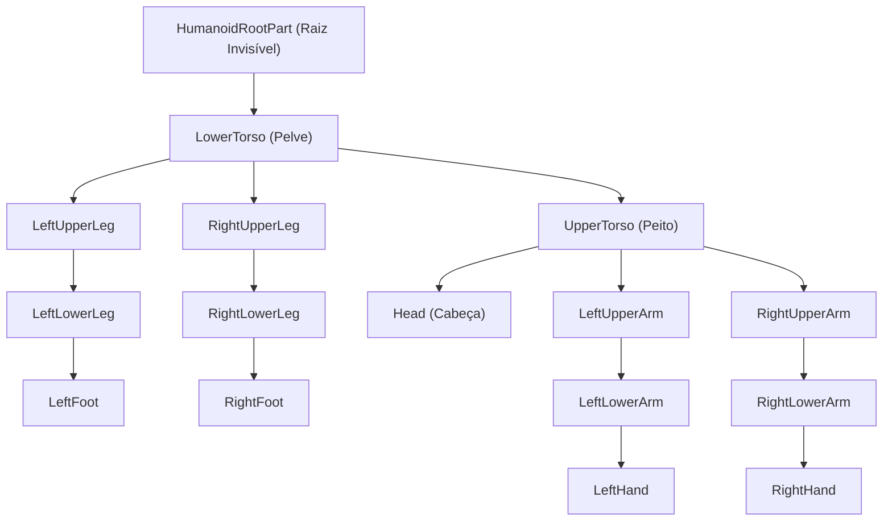

# 🎬 Guia Completo de Animação 3D & VFX (Roblox R15 + Blender)

Este documento descreve o fluxo de trabalho profissional para criar, editar, programar e importar animações 3D no padrão **Roblox R15** usando o **Blender** e o **Roblox Studio**.

---

## 📌 Sumário
1. [Estrutura do Rig R15](#1-estrutura-do-rig-r15)
2. [Fluxo de Produção (Pipeline)](#2-fluxo-de-produção-pipeline)
3. [Criando Animações no Blender](#3-criando-animações-no-blender)
4. [Princípios de Animação Anime de Alto Impacto](#4-princípios-de-animação-anime-de-alto-impacto)
5. [Exportando do Blender (Configurações do FBX)](#5-exportando-do-blender-configurações-do-fbx)
6. [Importando no Roblox Studio](#6-importando-no-roblox-studio)
7. [VFX In-Game: Técnicas do Twist VFX](#7-vfx-in-game-técnicas-do-twist-vfx)
8. [Sincronizando Animação Corporal + VFX + SFX](#8-sincronizando-animação-corporal--vfx--sfx)
9. [Assets e Sons](#9-assets-e-sons)

---

## 1. Estrutura do Rig R15

O padrão R15 divide o corpo do personagem em **15 partes articuladas**. Cada osso tem um nome fixo que o Roblox Studio exige para reconhecer o movimento:



### Motor6D Joints no R15

> **⚠️ REGRA CRÍTICA:** No Roblox R15, cada Motor6D joint vive **DENTRO da parte FILHA**, não da parte pai.
> Exemplo: `RightHip` está dentro de `RightUpperLeg`, **não** dentro de `LowerTorso`.

```lua
-- ✅ CORRETO:
local rightHip = character:WaitForChild("RightUpperLeg"):FindFirstChild("RightHip")

-- ❌ ERRADO (retorna nil):
local rightHip = rightFoot.Parent:FindFirstChild("RightUpperLeg")
-- (RightFoot.Parent = RightLowerLeg, que NÃO tem RightUpperLeg como filho)
```

**Tabela completa de joints:**

| Joint Name | Vive dentro de | Conecta |
|---|---|---|
| `Waist` | UpperTorso | LowerTorso → UpperTorso |
| `Neck` | Head | UpperTorso → Head |
| `RightHip` | RightUpperLeg | LowerTorso → RightUpperLeg |
| `LeftHip` | LeftUpperLeg | LowerTorso → LeftUpperLeg |
| `RightKnee` | RightLowerLeg | RightUpperLeg → RightLowerLeg |
| `LeftKnee` | LeftLowerLeg | LeftUpperLeg → LeftLowerLeg |
| `RightShoulder` | RightUpperArm | UpperTorso → RightUpperArm |
| `LeftShoulder` | LeftUpperArm | UpperTorso → LeftUpperArm |
| `RightElbow` | RightLowerArm | RightUpperArm → RightLowerArm |
| `LeftElbow` | LeftLowerArm | LeftUpperArm → LeftLowerArm |

---

## 2. Fluxo de Produção (Pipeline)

```
[ Blender: Modelagem & Keyframing ]
                │
                ▼ (Exportar .FBX)
[ animations/exports/nome_da_animacao.fbx ]
                │
                ▼ (Import FBX no Animation Editor)
[ Roblox Studio: Publicar na Roblox -> AnimationId ]
                │
                ▼ (Tocar via Script + VFX + SFX)
[ In-Game: Humanoid:LoadAnimation() + VFX Procedurais + EqualizerSoundEffect ]
```

---

## 3. Criando Animações no Blender

### Método A: Automatizado via Python (`bpy`)
Scripts Python geram poses exatas e curvas matemáticas:
📁 `animations/scripts/generate_geppo_anim.py` (v3.0 — Cinematic Edition)

```powershell
& "C:\Program Files\Blender Foundation\Blender 5.2\blender.exe" -b -P "animations/scripts/generate_geppo_anim.py"
```

### Método B: Manualmente pela Interface do Blender
1. Abra o Blender com o Rig R15 carregado.
2. Mude para a aba **Animation** no topo.
3. Selecione o esqueleto e entre em **Pose Mode** (`Ctrl + Tab`).
4. Selecione os ossos, use rotação (`R`) ou translação (`G`) e aperte `I` para inserir o keyframe de rotação/posição.
5. Abra o **Graph Editor** para ajustar as curvas de aceleração e desaceleração.

---

## 4. Princípios de Animação Anime de Alto Impacto

### As 4 Fases de Movimento (GEPPO v3.0)

1. **Antecipação (Anticipation) — Frames 0-2:**
   * Joelhos sobem violentamente ao peito (compressão de mola)
   * Braços cruzam sobre o corpo acumulando energia
   * Torso comprime e cabeça baixa (olhando para os pés)
   * Corpo desce ~0.30 studs (compressão visível)

2. **Impacto Explosivo (Explosive Stomp) — Frames 2-4:**
   * Transição em **2 frames** com tangentes Bezier ultra-steep
   * Perna direita PISÃO violento para baixo (extensão total)
   * Braços arremessados para baixo/trás (impulso tipo wing push)
   * Torso crunch agressivo para frente (absorvendo impacto)
   * Cabeça SNAPS UP dramaticamente (olhando para o céu)

3. **Ascensão + Air Drag (Follow-Through) — Frames 5-18:**
   * Corpo sobe rapidamente; pés/braços arrastados pelo vento
   * Dedos dos pés apontam para baixo (wind drag)
   * Braços trailing para trás no fluxo de ar
   * **Foot-planting**: pé direito mantém posição Y baixa enquanto root sobe

4. **Recuperação e Apex (Ease-Out) — Frames 18-30:**
   * Hang-time no apex (velocidade zero, corpo flutua)
   * Transição suave de volta para a pose de queda
   * Curvas Auto-Clamped para desaceleração gravitacional
   * **Frame 30 = Frame 0** (loop perfeito)

### Insights do Eduardo Bomerich (Opus 5.5 + Blender)

| Insight | Aplicação no Geppo |
|---|---|
| **IA é ruim para humanoides** | Keyframes manuais/matemáticos, não mocap |
| **Foot-planting IK** | Pé trava no ponto de impacto enquanto corpo sobe |
| **Weight painting falha em juntas** | Usar R15 joints pré-definidos (sem skinning livre) |
| **Vertex Groups errados** | Verificar path dos joints (bug do rightHip = nil) |

---

## 5. Exportando do Blender (Configurações do FBX)

* **Include:** `Selected Objects` (selecione apenas a Armature).
* **Transform:**
  * **Forward:** `-Z Forward`
  * **Up:** `Y Up`
* **Armature:**
  * Desmarque: `Add Leaf Bones` *(evita ossos fantasmas)*.
* **Bake Animation:**
  * `Bake Animation`: Marcado.
  * `Key All Bones`: Marcado.
  * `Simplify`: `0.0` *(preserva 100% da fidelidade)*.

---

## 6. Importando no Roblox Studio

1. Abra o seu jogo (`Jogodokaique.rbxl`) no **Roblox Studio**.
2. Abra o menu **Plugins** > **Animation Editor**.
3. Selecione o modelo do seu personagem (ou um Dummy R15 gerado pelo *Rig Builder*).
4. No Animation Editor, clique no ícone de três pontinhos (`...`) > **Import** > **From FBX**.
5. Selecione o arquivo exportado (ex: `animations/exports/geppo_skywalk.fbx`).
6. Revise a animação na linha do tempo.
7. Clique em `...` > **Publish to Roblox** e copie o **ID numérico** gerado (ex: `rbxassetid://123456789`).

---

## 7. VFX In-Game: Técnicas do Twist VFX

Referência: **Twist VFX** — *"How to Make Slash VFX | Roblox Studio"*

### 7.1 LightEmission = 1 (Anti-bordas pretas)
```lua
particles.LightEmission  = 1    -- Ignora sombras, texturas transparentes ficam limpas
particles.LightInfluence = 0    -- Não reage à iluminação ambiente
```

### 7.2 Partículas Congeladas no Ar (Fragmentos)
```lua
sparks.Speed       = NumberRange.new(0.01, 0.01)  -- Velocidade ~zero = congelada
sparks.Orientation = Enum.ParticleEmitterOrientation.VelocityPerpendicular
sparks.RotSpeed    = NumberRange.new(400, 500)     -- Giro extremo para Lifetime curto
```

### 7.3 Explosão Violenta que Para (Vento)
```lua
streaks.Speed = NumberRange.new(60, 80)       -- Velocidade alta = explosão
streaks.Drag  = 7                              -- Atrito alto = para instantaneamente
streaks.Orientation = Enum.ParticleEmitterOrientation.VelocityParallel  -- Estica
```

### 7.4 Highlight Senoidal no Personagem
```lua
-- EasingStyle.Circular = brilho pulsa como senoide, não troca de cor linear/dura
TweenService:Create(highlight,
    TweenInfo.new(0.07, Enum.EasingStyle.Circular, Enum.EasingDirection.Out),
    { FillTransparency = 0.35, OutlineTransparency = 0.15 }
):Play()
```

### 7.5 ZOffset para Controlar Z-Sorting
```lua
particles.ZOffset = 0.5   -- Controla qual camada renderiza por cima
-- Use diferenças de 0.001 para evitar que partículas cortem malhas 3D
```

### 7.6 Pegadinhas do Roblox Studio
- ❌ **Não rotacione Attachments em exatos 180°** → quebra renderização de `VelocityPerpendicular`
- ❌ **Beams cruzados** → Z-Sorting do Roblox falha (aceitar: em alta velocidade ninguém percebe)
- ✅ **Speed ≠ 0** para `VelocityPerpendicular` → senão partícula desaparece (use `0.01`)

---

## 8. Sincronizando Animação Corporal + VFX + SFX

### Timeline do Geppo v3.0 (~24fps in-game equivalente)

```
t=0.00s  │ Impulso físico (AssemblyLinearVelocity)
         │ FASE 0: Antecipação (joelhos sobem, torso comprime)
         │
t=0.05s  │ FASE 1: Stomp Explosivo (pernas ↓, braços ↓, cabeça ↑)
         │ SFX: Geppo Sound com EqualizerSoundEffect
         │ VFX: Core Flash + 8 Spikes + 4 Diag + Sparks Congeladas
         │ VFX: Ring #1 expande (dur 0.50s, ∅ 18 studs)
         │ VFX: Wind Streaks (Speed=75 Drag=7)
         │ VFX: Highlight Pulse (Circular easing)
         │
t=0.08s  │ VFX: Ring #2 (dur 0.65s, ∅ 22 studs)
         │
t=0.15s  │ FASE 2: Recuperação (todos joints voltam suavemente)
         │ VFX: Ring #3 (dur 0.80s, ∅ 27 studs)
         │
t=0.55s  │ Animação corporal completa (isAnimating = false)
```

### Scripts do Projeto

Sincronizados pelo Rojo (v3.1 — números, regras e efeitos separados):

* **[GeppoController.client.luau](src/client/GeppoController.client.luau)** → `StarterCharacterScripts.GeppoController`
  * Input (`Spacebar` no ar) + 10 Motor6D joints em 3 fases (antecipação → stomp → recuperação)
  * Publica o atributo `GeppoCharges` no personagem (lido pelo HUD)
* **[GeppoConfig.luau](src/shared/GeppoConfig.luau)** — cargas, cooldown, impulsos, frame de impacto
* **[GeppoState.luau](src/shared/GeppoState.luau)** — regras puras (testadas em `tests/GeppoState.spec.luau`)
* **[GeppoVFX.luau](src/shared/GeppoVFX.luau)** — `GeppoVFX.Fire(character, footPart)`: starburst + wind streaks + 3 rings + highlight + som (`SoundLibrary.play("geppo")`). Usa `VFXUtil`, compatível com o Phase Freeze.

---

## 9. Assets e Sons

| Asset | ID | Uso |
|---|---|---|
| **Geppo Sound** | `rbxassetid://96347429008558` | Som do pisão no ar |
| **Dash Sound** | `rbxassetid://128746179989349` | Som do dash (futuro) |
| **VFX Model** | Asset ID `137725942081281` | Modelo de referência do Marketplace |
| **Spark Texture** | `rbxassetid://296874871` | Partículas nítidas de faísca |

### Configuração do Som do Geppo
```lua
local eq = Instance.new("EqualizerSoundEffect")
eq.HighGain  = 0     -- Sem boost nos agudos
eq.LowGain   = 5     -- Boost nos graves (impacto)
eq.MidGain   = 5     -- Boost nos médios (presença)
eq.Priority  = 2     -- Prioridade de processamento
eq.Parent    = sound
```

---

*Criado para o desenvolvimento contínuo do projeto Roblox.*
*Atualizado com técnicas do Twist VFX e Eduardo Bomerich (out/2026).*
