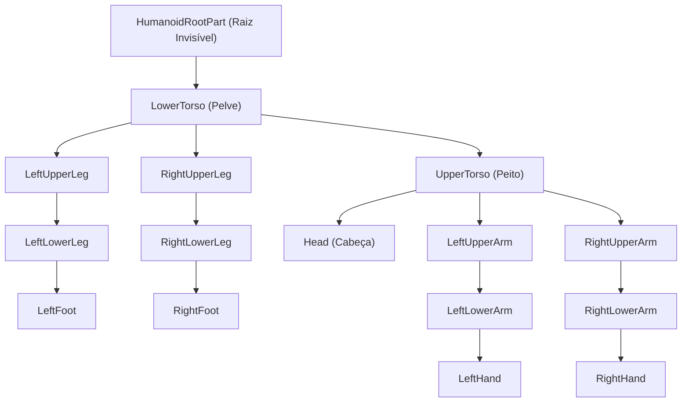

# 🎬 Guia Completo de Animação 3D & VFX (Roblox R15 + Blender)

Este documento descreve o fluxo de trabalho profissional para criar, editar, programar e importar animações 3D no padrão **Roblox R15** usando o **Blender** e o **Roblox Studio**.

---

## 📌 Sumário
1. [Estrutura do Rig R15](#1-estrutura-do-rig-r15)
2. [Fluxo de Produção (Pipeline)](#2-fluxo-de-produção-pipeline)
3. [Criando Animações no Blender](#3-criando-animações-no-blender)
4. [Princípios de Animação Anime de Alto Impacto](#4-princípios-de-animação-anime-de-alto-impacto)
5. [Exportando do Blender (Configurações do FBX)](#5-exportando-do-blender-configurações-do-fbx)
6. [Importando no Roblox Studio](#6-importando-no-roblox-studio)
7. [Sincronizando Efeitos Visuais (VFX de Vento e Áudio)](#7-sincronizando-efeitos-visuais-vfx-de-vento-e-áudio)

---

## 1. Estrutura do Rig R15

O padrão R15 divide o corpo do personagem em **15 partes articuladas**. Cada osso tem um nome fixo que o Roblox Studio exige para reconhecer o movimento:



> **Regra de Ouro:** Não altere a grafia dos nomes dos ossos. O Roblox Animation Editor procura exatamente por `UpperTorso`, `RightLowerArm`, etc.

---

## 2. Fluxo de Produção (Pipeline)

```
[ Blender: Modelagem & Keyframing ]
                │
                ▼ (Exportar .FBX)
[ animations/exports/nome_da_animacao.fbx ]
                │
                ▼ (Import FBX no Animation Editor)
[ Roblox Studio: Publicar na Roblox -> AnimationId ]
                │
                ▼ (Tocar via Script + VFX)
[ In-Game: Humanoid:LoadAnimation() + Efeitos de Vento ]
```

---

## 3. Criando Animações no Blender

### Método A: Automatizado via Python (`bpy`)
Usamos scripts Python para gerar poses exatas e curvas matemáticas. O nosso script modelo está em:
📁 `animations/scripts/generate_geppo_anim.py`

Para rodar qualquer gerador diretamente pelo terminal:
```powershell
& "C:\Program Files\Blender Foundation\Blender 5.2\blender.exe" -b -P "animations/scripts/generate_geppo_anim.py"
```

### Método B: Manualmente pela Interface do Blender
1. Abra o Blender com o Rig R15 carregado.
2. Mude para a aba **Animation** no topo.
3. Selecione o esqueleto e entre em **Pose Mode** (`Ctrl + Tab`).
4. Selecione os ossos, use rotação (`R`) ou translação (`G`) e aperte `I` para inserir o keyframe de rotação/posição.
5. Abra o **Graph Editor** para ajustar as curvas de aceleração e desaceleração.

---

## 4. Princípios de Animação Anime de Alto Impacto

Para evitar o visual "duro" ou robótico, siga as 4 fases de movimento:

1. **Antecipação (Anticipation):**
   * Antes de qualquer golpe ou pulo, o personagem deve encolher/recuar na direção oposta para acumular energia elástica.
   * *Exemplo no Geppo:* Encolher os joelhos até o peito e flexionar o torso para frente.
2. **Impacto Explosivo (Snappy Impact):**
   * O golpe acontece em **1 ou 2 frames** com aceleração máxima.
   * Use interpolação **Bezier** com alças inclinadas (*steep tangents*).
   * Contraste de forças: se o corpo chuta para baixo, a cabeça e o peito reagem com recuo para cima.
3. **Resistência do Ar & Membros Secundários (*Air Drag & Follow-Through*):**
   * Ao voar em alta velocidade, o vento empurra extremidades (pés caídos com dedos para baixo, braços arrastados para trás no fluxo de ar).
4. **Recuperação e Amortecimento (*Ease-Out*):**
   * O retorno para a postura de queda/repouso deve ser suave, com curvas *Auto-Clamped* desacelerando gradualmente como a gravidade agindo.
   * Para animações em *loop*, garanta que o **último frame seja matematicamente idêntico ao primeiro**.

---

## 5. Exportando do Blender (Configurações do FBX)

Ao exportar seu arquivo `.fbx` pelo Blender, use sempre estas opções:

* **Include:** `Selected Objects` (selecione apenas a Armature).
* **Transform:**
  * **Forward:** `-Z Forward`
  * **Up:** `Y Up`
* **Armature:**
  * Desmarque: `Add Leaf Bones` *(evita que o Blender crie ossos fantasmas nas pontas)*.
* **Bake Animation:**
  * `Bake Animation`: Marcado.
  * `Key All Bones`: Marcado.
  * `Simplify`: `0.0` *(preserva 100% da fidelidade das curvas)*.

---

## 6. Importando no Roblox Studio

1. Abra o seu jogo (`Jogodokaique.rbxl`) no **Roblox Studio**.
2. Abra o menu **Plugins** > **Animation Editor**.
3. Selecione o modelo do seu personagem (ou um Dummy R15 gerado pelo *Rig Builder*).
4. No Animation Editor, clique no ícone de três pontinhos (`...`) > **Import** > **From FBX**.
5. Selecione o arquivo exportado (ex: `animations/exports/geppo_skywalk.fbx`).
6. Revise a animação na linha do tempo.
7. Clique em `...` > **Publish to Roblox** e copie o **ID numérico** gerado (ex: `rbxassetid://123456789`).

---

## 7. Sincronizando Efeitos Visuais (VFX de Vento e Áudio)

Uma animação profissional fica completa com efeitos audiovisuais. Criamos dois scripts prontos no projeto:

* **[GeppoClient.luau](animations/scripts/GeppoClient.luau):**
  * Controla o pulo duplo no ar (`Spacebar` em queda livre).
  * Aplica impulso direcional (`AssemblyLinearVelocity`) levando em conta a direção do jogador (WASD).
  * Dispara o anel de ar sônico em néon e o estalo de vento.
* **[GeppoVFX.luau](animations/scripts/GeppoVFX.luau):**
  * Módulo reutilizável para instanciar partículas de vento e cilindros de choque expansivos debaixo de qualquer osso/pé.

---

*Criado para o desenvolvimento contínuo do projeto Roblox.*
