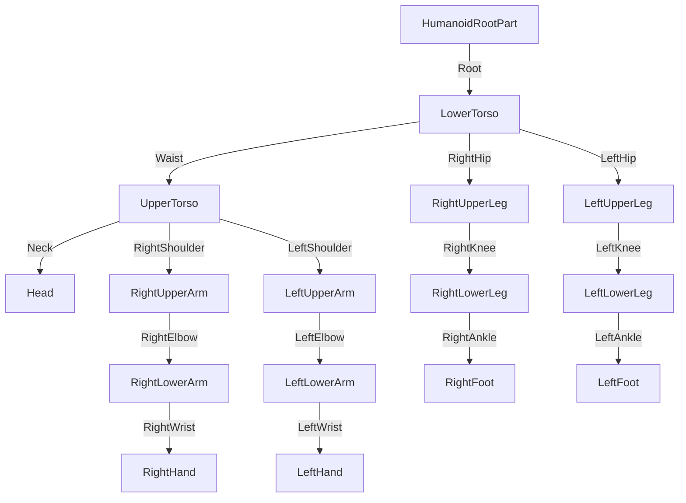

> **⚠️ REPOSITÓRIO APOSENTADO (28/10/2026).** O certo é **https://github.com/while-kaique/babau-piece**. Leia `MIGROU-PARA-BABAU-PIECE.md` antes de qualquer coisa e migre o que houver de novo neste PC para lá.

# 🎬 Guia de Animação R15 — Babau Piece (Blender por código → Studio → Roblox)

O método que usamos (outubro/2026): as poses são **escritas em Python** (graus por junta, nos
eixos do Roblox), conferidas **ao vivo no Blender** pelo MCP, viram uma **KeyframeSequence**
montada direto no Studio, são **testadas tocando no personagem real** e **publicadas pela Open
Cloud** — sem FBX, sem Animation Editor e sem nenhum clique do usuário.

Exemplo completo e vivo: o Geppo ([docs/GEPPO.md](docs/GEPPO.md),
`animations/scripts/generate_geppo_anims.py`). Lições curtas para o agente: skill
`.claude/skills/roblox-animation`.

---

## Sumário
1. [Por que este método](#1-por-que-este-método)
2. [Ambiente](#2-ambiente)
3. [O rig R15 do jogo](#3-o-rig-r15-do-jogo)
4. [Eixos e sinais](#4-eixos-e-sinais)
5. [Planejar a animação](#5-planejar-a-animação)
6. [Escrever o gerador](#6-escrever-o-gerador)
7. [Revisar no Blender](#7-revisar-no-blender)
8. [Importar no Studio](#8-importar-no-studio)
9. [Testar no jogo](#9-testar-no-jogo)
10. [Publicar](#10-publicar)
11. [Integrar no código](#11-integrar-no-código)
12. [Checklist de entrega](#12-checklist-de-entrega)
13. [Regras de qualidade](#13-regras-de-qualidade)
14. [Problemas e soluções](#14-problemas-e-soluções)

---

## 1. Por que este método

- **O rig do jogo é simples de descrever por números.** O R15 do Babau Piece usa
  `AnimationConstraint` (não Motor6D) com RigAttachments de rotação identidade. Então o
  `Pose.CFrame` de cada junta numa KeyframeSequence é só "a rotação da junta nos eixos do
  HumanoidRootPart, com pivô no attachment". Escrevendo as poses nesses eixos, o que se vê no
  Blender é exatamente o que toca no jogo (conferido: `CFrame.Angles(0.3, 0.5, 0.7)` sai igual
  nos dois lados).
- **Pose em tabela = iteração rápida.** Ajustar um braço é mudar um número e rodar de novo; o
  espelho (lado esquerdo, variante alternada) é uma função, não retrabalho.
- **Ver antes de entregar.** Cada etapa tem um "olho": `look` do Blender, screenshot do
  boneco de preview no Studio, foto congelada no personagem real e medição por quadro.
- **Zero cliques do usuário.** Blender e Studio pelo MCP, publicação pela chave Open Cloud.

## 2. Ambiente

| Peça | Onde / como |
|---|---|
| Blender 5.2 | `C:\Program Files\Blender Foundation\Blender 5.2\blender.exe`. Se o MCP `blender` não conectar (`get_addon_status`), abra o Blender: o addon sobe o servidor sozinho |
| Roblox Studio | Babau Piece aberto, MCP `robloxstudio` conectado |
| Rojo | `rojo serve` sincroniza `src/` (confira a versão no Studio antes de testar — §14) |
| Chave Open Cloud | `.env` (ignorado pelo git): `ROBLOX_API_KEY`, `ROBLOX_CREATOR_ID=3465482970`. Escopo `asset` read+write |
| Python | stdlib apenas (`scripts/opencloud_upload.py`, `anim_to_luau.py`) |

Arquivos do pipeline:

| Arquivo | Função |
|---|---|
| `animations/rig/r15_rig.json` | Rig R15 real medido no Studio: pivô de cada junta, centro/tamanho de cada parte |
| `animations/scripts/r15_lib.py` | `build_rig()`, `key()`, `export_json()`, `render_frames()`, conversões de eixo |
| `animations/scripts/generate_template_anim.py` | Modelo de gerador (copie para começar) |
| `animations/scripts/generate_geppo_anims.py` | Gerador real com várias animações, `espelhar()` e `trocar_membros()` |
| `animations/exports/<nome>.anim.json` | Saída: Pose.CFrame de cada junta em cada quadro + markers |
| `studio-tools/anim_import.luau` | Monta `ServerStorage.AnimacoesGeradas.<nome>` e posa `Workspace.AnimPreview` |
| `animations/scripts/anim_to_luau.py` | Gera o script de import pronto para o `execute_luau` |
| `scripts/opencloud_upload.py` | Publica o `.rbxm` como Animation e devolve o assetId |

> ⚠️ Nunca rode `bpy.ops.wm.read_factory_settings` no Blender aberto: ele recarrega os addons
> e derruba o servidor do MCP (aí é fechar o processo e abrir de novo). O `r15_lib` limpa a
> cena apagando objetos.

## 3. O rig R15 do jogo



- No Blender, **cada bone tem o nome da junta** (Root, Waist, RightShoulder…), com a cabeça do
  bone no pivô real (do `r15_rig.json`). O nome da parte filha fica em `bone["part"]`.
- O `build_rig()` também cria blocos do corpo presos aos bones (cabeça amarela com "nariz"
  marcando a frente), para enxergar a pose.
- Escala 1:1 (1 unidade = 1 stud), pés em z = 0, personagem olhando para −Y no Blender
  (a vista frontal mostra o rosto). Conversão: `(x, y, z)` Roblox = `(−x, z, y)` Blender.
- O rig foi medido de `Players:CreateHumanoidModelFromDescription(HumanoidDescription.new(), R15)`.
  Se o jogo mudar de corpo, meça de novo e atualize o JSON.

## 4. Eixos e sinais

Rotação de cada junta em **graus, igual a `CFrame.Angles(rx, ry, rz)`** (Rx·Ry·Rz), no espaço
da junta = HumanoidRootPart em repouso: **X direita, Y cima, −Z frente**.

| Junta | Eixo | Efeito |
|---|---|---|
| Ombro / quadril | X+ | membro vai para a **frente** (90 = horizontal à frente, 180 = para cima) |
| Ombro direito | Z+ | abre o braço pelo lado (ombro **esquerdo: Z−**) |
| Quadril | Z | abre a perna (direita Z+, esquerda Z−) |
| Cotovelo | X+ | dobra o antebraço para a frente |
| Joelho | X− | dobra a perna para trás |
| Tornozelo | X− | aponta a ponta do pé para baixo |
| Pescoço | X+ | olha para cima; **Y+ olha para a esquerda** do personagem |
| Waist | Y | torce o tronco; Z inclina de lado |
| Root | X− | inclina o corpo todo para a **frente**; **Z− para a direita** |
| Root (posição) | `((rx, ry, rz), (px, py, pz))` | move o corpo todo (py < 0 agacha) |

> **Inclinar o tronco leva os membros pendurados junto.** Root X−38 (frente) joga braços e
> pernas 38° para trás; Root Z−38 (direita) joga para a esquerda. Some ou subtraia isso no
> ombro/quadril. Exemplo real: para o braço esquerdo "empurrar para baixo/fora" a ~30° com o
> tronco inclinado 46°, o ombro esquerdo ficou em Z **+12** (fechando), não em Z−20.

## 5. Planejar a animação

1. **Parta da física, não do olho.** Meça no jogo quanto a ação dura (ex.: Geppo para cima
   ImpulseY 67,4 com gravidade 196,2 → topo em 0,34 s; dash 0,30 s; próximo Geppo pode vir em
   0,22 s). A pose principal tem que caber nesse tempo.
2. **Fases** (60 fps): neutro → **antecipação** (oposta à ação, curta) → **impulso** (1–3
   quadros de "snap") → **pose viva** (continua se mexendo, nunca congela) → **soltar**.
3. **Markers** no plano: `Impacto` (VFX/SFX) e `Soltar` (onde a trilha começa a sumir).
4. Mostre o plano ao usuário como tabela tempo × pose quando a animação for nova e grande.
   Exemplo (Geppo cima):

| Tempo | Etapa | Pose |
|---|---|---|
| 0,00 | entrada | da pose atual, fade 0,05 s |
| 0,05 | encolher (marker Impacto) | joelhos sobem, tronco curva, punho perto do ombro |
| 0,10 | impulso | perna direita estica para baixo, esquerda dobrada no alto, braço direito para o alto |
| 0,20 | subida | mesma pose, ainda indo (braço alcança mais) |
| 0,30 | soltar (marker) | começa a sumir e a queda assume |

## 6. Escrever o gerador

Copie `generate_template_anim.py` (uma animação) ou siga `generate_geppo_anims.py` (várias):

```python
NEUTRO = {j: (0, 0, 0) for j in JUNTAS}
NEUTRO["Root"] = ((0, 0, 0), (0, 0, 0))

CIMA = {
    0: NEUTRO,
    3: {"Root": ((-8, 0, 0), (0, 0.15, 0)), "RightShoulder": (75, 0, 10), "RightElbow": (70, 0, 0), ...},
    6: {"Neck": (28, 0, 0), "RightShoulder": (158, 0, 12), "LeftHip": (85, 0, 0), "LeftKnee": (-100, 0, 0), ...},
    12: {...},
    18: {...},  # SOLTAR
}
ANIMS = {"GeppoCima": CIMA, "GeppoCimaB": espelhar(CIMA), ...}
```

- `key(arm, frame, poses)` grava em **quaternion** (não Euler) — sem "rebolado" no meio.
- Junta omitida num quadro não ganha chave ali. Posição só com a forma `((rot), (pos))` —
  use-a em todas as chaves daquela junta.
- `espelhar(keys)`: lado oposto (troca Right↔Left, inverte Y/Z e X da posição).
  `trocar_membros(poses)`: troca só braços/pernas, mantendo tronco e cabeça (variante
  alternada de um movimento lateral).
- O último quadro repete o de `Soltar` (a trilha some por fade antes de acabar).
- `export_json(arm, nome, priority=..., markers={"Impacto": 3, "Soltar": 18})` amostra
  todo quadro (Easing Linear no Roblox = fiel às curvas Bezier do Blender) e omite juntas em
  identidade.

## 7. Revisar no Blender

- **Ao vivo (preferido):**
  `exec(open(p, encoding="utf-8").read(), {"__file__": p, "SO": "GeppoDireita"})` pelo
  `execute_blender_code`, depois `look` com `mode="frames"`, `frames=[3, 6, 12, 18]`.
- **Escolha a vista pela pose:** inclinação para a frente → lateral (`[-1, -0.05, 0.1]`);
  inclinação lateral → `front`; geral → 3/4 (`[-0.9, -0.6, 0.15]`). Na vista frontal a
  direita do personagem aparece à **esquerda** da imagem.
- **Lote/headless:** `blender -b --factory-startup -P animations/scripts/<gerador>.py` gera
  todos os JSONs e renders em `animations/exports/<nome>_fNN.png` (apague os PNGs depois).
- Pergunte para cada quadro: o membro aponta para onde o plano diz? Algo some atrás da
  cabeça? A transição entre quadros-chave passa por dentro do corpo?

## 8. Importar no Studio

1. Servidor local em background (o `execute_luau` roda como plugin e pode ler localhost):
   `python -m http.server 8765 --bind 127.0.0.1 --directory animations/exports`
2. `python animations/scripts/anim_to_luau.py <nome> --t 0.2` → `build/anim_import_<nome>.luau`
   → Read → `execute_luau` (modo edição). Cria `ServerStorage.AnimacoesGeradas.<nome>` com os
   markers e posa `Workspace.AnimPreview` no tempo `--t`.
3. `selection view` em `Workspace.AnimPreview` → `capture_screenshot`. Repita com outros `--t`.
   No fim, `--mode clear` e pare o servidor.

O preview posa por **cinemática direta** com as partes ancoradas
(`parte1 = parte0 · Attachment0 · Pose · Attachment1⁻¹`): em modo edição o
AnimationConstraint não é resolvido (é física) e escrever `Transform` não mexe nada.

## 9. Testar no jogo

1. `solo_playtest` → `eval_server_runtime`: `player:LoadCharacter()` (o Babau só cria o
   personagem depois do menu) e clona a KeyframeSequence para ReplicatedStorage.
2. Cliente: `KeyframeSequenceProvider:RegisterKeyframeSequence(seq)` → id temporário. O
   GeppoController aceita esse id pelo atributo `GeppoAnim<Tipo>Teste` no personagem.
3. **Meça, não só olhe.** Amostrador no Heartbeat gravando posição, velocidade,
   `TimePosition@WeightCurrent` das trilhas e o ângulo de um membro por quadro (Δ°). Régua
   usada: impulso proposital ~40°/quadro; transição entre Geppos ≤ ~35°/quadro.
4. **Foto da pose no personagem real:** ancore o root, `track.TimePosition = t;
   track:AdjustSpeed(0)`, desligue as ScreenGuis do PlayerGui e prenda a câmera com
   `RunService:BindToRenderStep(nome, Enum.RenderPriority.Last.Value + 10, ...)` (a câmera do
   Babau sobrescreve qualquer outra coisa).
5. Teclado: `simulate_keyboard_input` (chamadas seguidas saem ~0,2 s uma da outra). Antes,
   solte W/A/S/D (o simulador às vezes deixa teclas presas) e confira `UIS:IsKeyDown`.

## 10. Publicar

```bash
# no Studio (MCP): export_rbxm de ServerStorage.AnimacoesGeradas.<nome> → build/<nome>.rbxm
python scripts/opencloud_upload.py build/<nome>.rbxm --type Animation --name "<nome>" --description "..."
# última linha = assetId; moderação volta "Approved" em segundos
```

- Tem que ser na **conta dona do jogo** (3465482970), senão a animação não toca.
- O `upload_asset` do MCP falha com "Unknown error": use o script.
- Chave expirada/sem permissão: veja `docs/GEPPO.md`/memória — página certa
  `create.roblox.com/dashboard/credentials?activeTab=ApiKeysTab` (Assets API read+write).

## 11. Integrar no código

Padrão do `GeppoController` (copie para habilidades novas):

- **Ids no config** (`GeppoConfig.Animations`), nunca soltos no código.
- **Pré-carregar ao nascer**: `ContentProvider:PreloadAsync({animation...})` — sem isso o
  primeiro uso sai sem animação (também no jogo publicado).
- **Duas trilhas por animação, alternadas**: `Play` numa trilha que já toca volta ao quadro 0
  na hora (corte). Encadeado = crossfade da trilha atual para a nova (fade 0,10 encadeado;
  0,05 vindo do nada).
- **Marker `Soltar` → `track:Stop(fade)`**: a volta é a mistura com a animação de baixo (a
  queda do Animate tem braços erguidos), não um quadro neutro.
- **Prioridade** Action2 para habilidade por cima de correr/cair; parar com fade ao pousar.
- **VFX/SFX** no tempo do marker `Impacto` (ou `ImpactDelay` igual), no membro que faz a ação.
- Pose lateral precisa do corpo de lado para o movimento: desligue `AutoRotate` e gire o root
  para a frente da câmera enquanto durar.

## 12. Checklist de entrega

- [ ] Plano por fase/tempo coerente com a física medida
- [ ] Todas as poses conferidas no Blender (vista certa para cada uma)
- [ ] Preview no Studio + foto congelada no personagem real
- [ ] Medição no playtest (sem picos estranhos de Δ°, sem cortes de peso)
- [ ] Publicada pela Open Cloud, id no config, pré-carregada
- [ ] `scripts/check.ps1 -Fix` → "Tudo verde"
- [ ] Studio com a mesma versão dos arquivos (`#Source` = bytes do arquivo)
- [ ] Playtest final sem ids de teste; logs sem erro (filtre por "attempt")
- [ ] Lições novas na skill; documentação (`docs/`) atualizada; lembrar o usuário do Ctrl+S

## 13. Regras de qualidade

- **Impacto de anime**: antecipação curta e oposta, 1–3 quadros de snap, recuperação longa.
- **Nada congela**: a pose principal continua indo (braço alcança mais, cabeça sobe mais).
- **Caminho curto entre poses encadeadas**: na antecipação do Geppo o braço que estava no alto
  só dobra o cotovelo (punho perto do ombro) em vez de descer inteiro — o pico caiu de 57°
  para 34°/quadro.
- **Leitura pela câmera**: braço colado na cabeça some atrás do cabelo — deixe ~110° no mundo.
- **Compense a inclinação do tronco** nos membros (§4).
- **Variação viva**: encadeados alternam lado (perna que empurra, braço que lidera).

## 14. Problemas e soluções

| Sintoma | Causa | Solução |
|---|---|---|
| Animação não mexe nada | Código animando `Motor6D.C0` | O rig é AnimationConstraint: use AnimationTrack |
| Braço "rebola" no meio do movimento | Euler num bone inclinado | Quaternion (já é o padrão do `key()`) |
| Ao terminar, braço desce e sobe de novo | Último quadro neutro ≠ animação de baixo | Marker `Soltar` + `Stop(fade)` |
| Corte ao repetir rápido | `Play` reinicia a trilha | Duas trilhas + crossfade |
| 1º uso sem animação | Asset ainda baixando | `PreloadAsync` ao nascer |
| Preview no Studio parado | AnimationConstraint não resolve em edição | Preview por cinemática direta (já no `anim_import`) |
| MCP do Blender caiu | `read_factory_settings` | Fechar e reabrir o Blender |
| Peça do corpo na origem (headless) | `transform_apply` aplicou posição / pose não avaliada | `location=False` e `view_layer.update()` (já no `r15_lib`) |
| Playtest com comportamento antigo | Rojo perdeu uma sincronização | Comparar `#Source` com o arquivo; `set_script_source` |
| Erro não aparece no log | Filtro errado | Erros de script são "attempt to ..." |
| Script de import gigante | JSON embutido (~30 KB) | Servidor local + `GetAsync` (padrão) |
| Upload pelo MCP falha | `upload_asset` quebrado | `scripts/opencloud_upload.py` |
